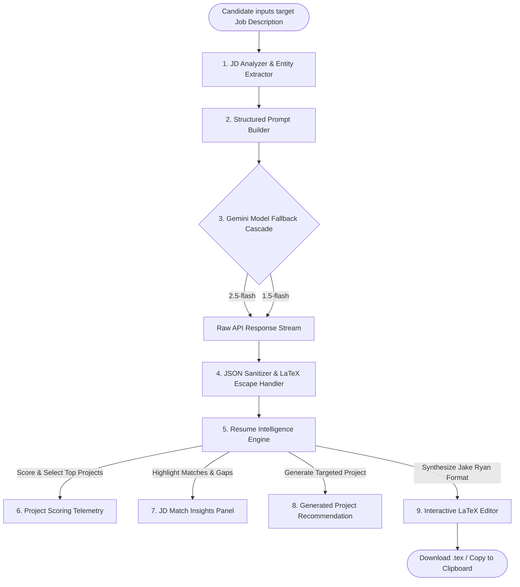

# ResumeForge AI (Mission Control v3.0)

### Client-Side Generative AI Engine for Dynamic Job-Targeted LaTeX Resumes

[](LICENSE)
[](https://developer.mozilla.org)
[](https://developer.mozilla.org)
[](https://developer.mozilla.org)
[](https://ai.google.dev)
[](https://overleaf.com)
[](https://overleaf.com)

[Overview](#overview) | [Core Capabilities](#core-capabilities) | [Comparative Matrix](#comparative-matrix) | [Pipeline Architecture](#pipeline-architecture) | [Quick Start](#quick-start)

---

## Overview

ResumeForge AI is a high-performance, client-side web application designed to dynamically adapt AI and machine learning engineering resumes to specific Job Descriptions (JDs) with quantitative precision. Powered directly in-browser via the Google Gemini API, the platform analyzes candidate portfolios, scores project relevance against JD requirements, generates missing target-specific engineering deliverables, and compiles standard, ATS-optimized one-page LaTeX resumes using the industry-standard Jake Ryan formatting schema.

Operating with zero server dependencies, all candidate profile records and API exchanges remain strictly localized within the browser, ensuring complete data privacy.

---

## Core Capabilities

- **Automated JD Decomposition:** Extracts programming languages, frameworks, AI/ML domains, DevOps tooling, and key business responsibilities directly from raw job postings.
- **Weighted Project Scoring:** Evaluates candidate projects on a 100-point rubric factoring in Technology Alignment (40%), Keyword Overlap (25%), Domain Match (20%), and Measurable Business Impact (15%).
- **Gap-Filling Project Generation:** Pinpoints critical competencies missing from the candidate's existing portfolio, drafting a production-grade, repo-ready project to replace the lowest-scoring entry.
- **Hyperlinked LaTeX Generation:** Integrates clickable contact links and project repositories using the `hyperref` and `fontawesome5` LaTeX packages, ready for instant compilation on Overleaf or local TeX engines.
- **Single-Page Constraint Enforcement:** Dynamically balances whitespace, margin geometry, and bullet counts to guarantee that compiled output strictly adheres to a single page.
- **Multi-Model Fallback Chain:** Implements client-side resilience by cycling through active Google Gemini models (`gemini-2.5-flash`, `gemini-1.5-flash`) with exponential backoff on HTTP 429 quota exhaustion.

---

## Comparative Matrix

| Capability | Traditional Resume Builders | ResumeForge AI |
| :--- | :---: | :---: |
| **JD-Targeted Customization** | Manual copy-pasting | Automated semantic alignment |
| **Portfolio Evaluation** | Static layout templates | Quantitative relevance scoring |
| **Technical Gap Mitigation** | Unaddressed | Automated synthetic project generation |
| **Document Compiler** | Plain PDF or DOCX export | Compilable Jake Ryan LaTeX output |
| **Link Integrity** | Raw text URLs | Interactive clickable LaTeX hyperlinks |
| **Data Privacy** | Cloud server storage | 100% Client-side execution in LocalStorage |

---

## Pipeline Architecture



---

## Execution Pipeline Stages

```
1. JD Analysis           -> Extracts tech stack, requirements, and keywords
2. Project Scoring       -> Computes weighted match scores for candidate portfolio
3. Project Selection     -> Selects top candidate entries matching JD criteria
4. Project Generation    -> Drafts tailored project addressing missing competencies
5. Project Insertion     -> Injects highest-value project replacement
6. Skills Filtering      -> Prioritizes relevant technologies and libraries
7. Certificate Ranking   -> Selects domain-relevant credentials
8. Bullet Point Tuning   -> Re-indexes action verbs and impact metrics
9. Header Linking        -> Converts raw text into clickable LaTeX macros
10. Constraint Audit     -> Validates layout to fit within one standard page
```

---

## Repository Layout

```text
resume-generator/
|-- .github/
|   |-- ISSUE_TEMPLATE/
|   |   |-- bug_report.md
|   |   +-- feature_request.md
|   +-- PULL_REQUEST_TEMPLATE.md
|-- CHANGELOG.md
|-- CODE_OF_CONDUCT.md
|-- CONTRIBUTING.md
|-- LICENSE
|-- SECURITY.md
|-- index.html          # Mission Control application interface
|-- index.css           # Vanilla CSS design system and layout
|-- app.js              # Pipeline controller and Gemini API client
+-- screenshot.png      # Application interface reference
```

---

## Technical Specifications

- **Frontend Core:** Vanilla HTML5, CSS3 Custom Properties (HUD theme, soft contrasts, responsive grid).
- **Application Logic:** Vanilla ES6+ JavaScript.
- **Inference Provider:** Google Gemini API (v1beta REST interface).
- **Output Standard:** Jake Ryan LaTeX resume schema via `fontawesome5` and `hyperref`.
- **Local Persistence:** HTML5 LocalStorage API for configuration, active API keys, and candidate profiles.

---

## Quick Start

### Prerequisites
- Modern web browser (Chrome, Edge, Firefox, or Safari).
- Google Gemini API Key from [Google AI Studio](https://aistudio.google.com/).

### 1. Installation

```bash
git clone https://github.com/Ma-nas/ResumeForge-AI.git
cd ResumeForge-AI
```

### 2. Execution

Open `index.html` directly in your browser, or launch using any static HTTP file server:

```bash
# Using Python built-in HTTP server:
python -m http.server 3000

# Using Node http-server:
npx http-server . -p 3000
```

Navigate to `http://localhost:3000`.

### 3. Usage Flow

1. Input your Gemini API key in the credentials modal on initial launch.
2. Paste the target Job Description into the JD panel.
3. Select **Execute Mission** (or press `Ctrl+Enter`).
4. Inspect the computed relevance metrics, review the generated target project, and copy or download the compiled `.tex` resume code for Overleaf compilation.

---

## License

Distributed under the MIT License. See [LICENSE](LICENSE) for full details.
